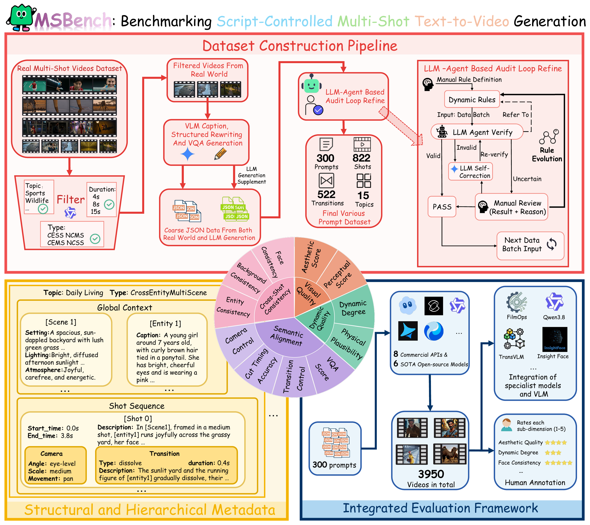
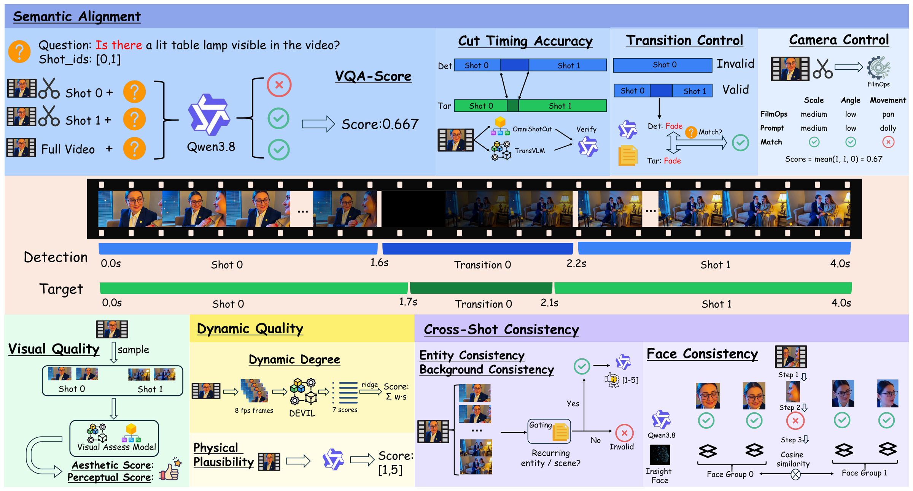

<div align="center">

[中文文档](README_zh.md)

# <a href="https://totalhuang.github.io/MSBench-page/"></a> MSBench: Benchmarking Script-Controlled Multi-Shot Text-to-Video Generation

Tao Huang<sup>1</sup>, ZiHao Liang<sup>1</sup>, Junhao Liu<sup>2</sup>, Junzhe Li<sup>2</sup>, Yuancheng Wei<sup>2</sup>,
Sifan Zuo<sup>1</sup>, Beiming Yu<sup>1</sup>, Taojin Liu<sup>1</sup>, Zhuoyang Li<sup>1</sup>, Bing Cao<sup>1</sup>

<sup>1</sup>Tianjin University &nbsp;&nbsp; <sup>2</sup>Peking University

<a href="https://totalhuang.github.io/MSBench-page/"></a>
<a href="https://arxiv.org/abs/2611.29417"></a>
<a href="https://huggingface.co/datasets/totalhuang/MSBench"></a>

</div>

<p align="center"></p>

## 🔥 News

- **[2026.11]** 🎉 We release the paper, the evaluation code and the 300 benchmark prompts.

## ✅ TODO List

- [x] Release the paper ([arXiv](https://arxiv.org/abs/2611.29417))
- [x] Release the evaluation code
- [x] Release the 300 benchmark prompts (4 s / 8 s / 15 s scripts, [Hugging Face](https://huggingface.co/datasets/totalhuang/MSBench))
- [ ] Release the generated videos of the evaluated systems

## 🔎 Overview

MSBench evaluates whether a text-to-video system can follow a **multi-shot script**: each script specifies, for every
shot, its time span, camera (scale, angle, movement), content, and the transition into the next shot.

- **300 Scene-Entity-Shot scripts** with 822 shots and 522 transitions over 15 topics, in three durations: 125 × 4 s and
  125 × 8 s (base set) plus 50 × 15 s (extension).
- **Four dimensions, 11 sub-metrics.** Visual Quality (Aesthetic, Perceptual), Dynamic Quality (Dynamic Degree,
  Physical Plausibility), Semantic Alignment (VQA, Transition Control, Cut Time Accuracy, Camera Control) and Cross-Shot
  Consistency (entity, background, face).
- **Hybrid, human-validated evaluation.** Shot boundaries and transition types come from dedicated detectors
  (OmniShotCut, TransVLM) checked by a VLM judge; each sub-metric uses the expert model or judge prompt that agreed best
  with human ratings. Every evaluator model is open-weight; the VLM judge is Qwen3.8-27B.

<p align="center"></p>

## 🏆 Leaderboard

Base set (250 scripts of 4 s and 8 s); scores in [0, 100], Final = mean of the four dimensions. The last column is the
15 s extension, evaluated for systems that generate 15 s natively.

| # | System | Type | Open weights | VQ | DQ | SA | CSC | **Final** | 15 s Final |
|---:|---|---|:---:|---:|---:|---:|---:|---:|---:|
| 1 | Seedance 2.0 | Native multi-shot |  | 83.9 | 77.0 | 73.6 | 84.0 | **79.6** | 79.2 |
| 2 | MiniMax H3 | Native multi-shot | ✓ | 85.7 | 79.0 | 72.1 | 78.9 | **78.9** | 79.5 |
| 3 | Kling 3.0 | Native multi-shot |  | 80.7 | 76.9 | 66.5 | 73.0 | **74.3** | 77.4 |
| 4 | Wan2.6 | Native multi-shot |  | 87.7 | 77.3 | 57.8 | 61.7 | **71.1** | 77.1 |
| 5 | Veo3.1 | Native multi-shot |  | 88.5 | 67.7 | 61.9 | 66.1 | **71.1** | - |
| 6 | Sora2 Pro | Native multi-shot |  | 71.8 | 68.4 | 69.7 | 74.1 | **71.0** | - |
| 7 | Jimeng3.0 Pro | Native multi-shot |  | 89.4 | 77.0 | 52.1 | 57.2 | **68.9** | - |
| 8 | HoloCine | Multi-shot specialist | ✓ | 71.5 | 72.6 | 61.0 | 66.0 | **67.8** | 68.6 |
| 9 | MultiShotMaster | Multi-shot specialist | ✓ | 80.5 | 62.4 | 62.6 | 61.8 | **66.8** | 70.8 |
| 10 | VideoGen-of-Thought | Multi-shot specialist | ✓ | 89.0 | 54.2 | 52.1 | 44.9 | **60.0** | 60.0 |
| 11 | Wan2.2 | Conventional T2V | ✓ | 85.5 | 78.7 | 38.7 | 31.0 | **58.5** | 48.5 |
| 12 | Kling 2.6 | Conventional T2V |  | 85.7 | 75.8 | 35.9 | 18.2 | **53.9** | - |
| 13 | HunyuanVideo-1.5 | Conventional T2V | ✓ | 81.7 | 75.5 | 34.5 | 19.9 | **52.9** | 46.0 |
| 14 | Hailuo 2.3 | Conventional T2V |  | 77.9 | 77.3 | 31.9 | 12.1 | **49.8** | - |

## 📏 Metrics

| Dimension | Sub-metric | How it is computed |
|---|---|---|
| Visual Quality | Aesthetic Score (AS) | Q-Align video prompt on 4 fps frames of each shot, duration-weighted |
| | Perceptual Score (PS) | DeQA-Score on 8 fps frames, duration-weighted, / 5 |
| Dynamic Quality | Dynamic Degree (DD) | 7 DEVIL motion components, frozen ridge model fitted to human ratings |
| | Physical Plausibility (PP) | Qwen3.8 failure checklist, expected 1-5 score |
| Semantic Alignment | VQA Score | script yes/no questions asked on the shot windows and the whole video |
| | Transition Control (TC) | requested vs. detected transition types after order-preserving alignment |
| | Cut Time Accuracy (CTA) | exp(−timing error / duration) between scripted and detected shots |
| | Camera Control (CC) | FilmOps scale / angle / movement of each shot vs. the script |
| Cross-Shot Consistency | Entity (CSEC) / Background (CSBC) | Qwen3.8 expected 1-5 score, where the script asks for it |
| | Face (CSFC) | InsightFace + Set-of-Mark identification, calibrated cross-shot similarity |

Cross-shot metrics need at least two detected shots; an applicable video without them scores 0. See
[docs/METRICS.md](docs/METRICS.md) for every setting, and `msbench/prompts/` for the judge prompts.

## 🛠️ Environment

Tested on Linux with NVIDIA GPUs (one 48 GB GPU runs every model; FilmOps `camera_movement` needs ~40 GB VRAM and
TransVLM is the next largest), Python 3.10–3.12, CUDA 12.x (Blackwell / `sm_120` GPUs need `cu128` PyTorch wheels) and
FFmpeg. Q-Align and DeQA pin old `transformers` versions, so they get their own environments; everything else runs in
the main one. With `uv` (`UV_LINK_MODE=hardlink`), all three environments can share one cached PyTorch/CUDA install on
disk instead of duplicating it three times.

```bash
git clone https://github.com/totalhuang/MSBench.git MSBench && cd MSBench

# main environment
conda create -n msbench python=3.10 -y && conda activate msbench
pip install torch==2.8.0 torchvision==0.23.0 torchaudio==2.8.0 --index-url https://download.pytorch.org/whl/cu126
pip install -r requirements/main.txt && pip install -e .
bash scripts/setup_third_party.sh          # OmniShotCut, TransVLM, DEVIL, dinov2, FilmOps, Q-Align -> third_party/

# Q-Align environment (Aesthetic Score)
conda create -n msbench-qalign python=3.10 -y && conda activate msbench-qalign
pip install torch==2.6.0 torchvision==0.21.0 torchaudio==2.6.0 --index-url https://download.pytorch.org/whl/cu124
pip install -r requirements/qalign.txt && pip install --no-deps -e third_party/Q-Align && pip install -e .

# DeQA environment (Perceptual Score)
conda create -n msbench-deqa python=3.10 -y && conda activate msbench-deqa
pip install torch==2.6.0 torchvision==0.21.0 torchaudio==2.6.0 --index-url https://download.pytorch.org/whl/cu124
pip install -r requirements/deqa.txt && pip install -e .
```

## 🧱 Download

**Expert models** (about 78 GB, into `models/`):

```bash
bash scripts/download_models.sh
```

The script uses `hf download --include` / `--exclude` to fetch only the weights required by MSBench (e.g. only
`shot_scale`, `camera_angle`, and `camera_movement` from `Neo961/FilmOps`, plus `dinov2_vitb14_pretrain.pth` for
`shot_scale`, and `safetensors` only from `zhiyuanyou/DeQA-Score-Mix3`). `raft-things.pth` from `princeton-vl/RAFT`
still needs to be placed in `models/DEVIL/` manually (see `models/README.md`).

**Benchmark scripts.** `data/benchmark.json` (300 scripts) ships with the repository; the same scripts are on
[Hugging Face](https://huggingface.co/datasets/totalhuang/MSBench). Each key is a sample id; a script has `global_context`, `entities_info`, `shot_sequence`
(per-shot time span, camera, description, transition), `t2v_prompt` (the text prompt given to the system),
`VQA_questions`, `eval_metrics` (which cross-shot metrics apply), `background_group` and `duration_s`.

## 🤖 VLM Judge

Five stages ask Qwen3.8-27B: transition types, face identification, PP, CSEC/CSBC and VQA. Two ways to reach it:

**1. Alibaba Cloud Model Studio (default, used for the paper).** Create an API key for DashScope (百炼) and put it in `.env`:

```bash
cp .env.example .env    # then set DASHSCOPE_API_KEY=...
```

**2. Your own deployment.** Serve Qwen3.8-27B behind any OpenAI-compatible API (we tested vLLM) and point MSBench at it:

```bash
python -m msbench judge --metric pp --results results/my_model \
    --judge-backend openai --judge-url http://<ip>:<port>/v1 --judge-model Qwen3.8-27B
```

or set `MSB_JUDGE_BACKEND=openai`, `MSB_JUDGE_URL`, `MSB_JUDGE_MODEL` in `.env`. MSBench does not ship deployment code.
With vLLM, the frame rate is passed through `media_io_kwargs` / `mm_processor_kwargs`; set `MSB_JUDGE_PLAIN=1` for
servers that reject these fields. A self-hosted judge gives scores close to, but not identical with, the API.

Every judge stage accepts `--dry-run` (count requests, print one prompt, no API call). For one system on all 300
scripts the judge receives roughly 1,100 video requests (PP 300, VQA 300, CSEC ~160, CSBC ~200, about 2 × 150
transition-type requests) of ~10-23k input tokens each, plus ~2,000 short image requests for face identification.

## 🚀 Quick Start

**Smoke test.** `videos/example/` holds two videos (8 s and 15 s, Seedance 2.0) for which every sub-metric applies.
This runs the whole pipeline on them and compares the scores with the paper run (`tests/reference_scores.json`):

```bash
bash scripts/smoke_test.sh            # add --judge-backend openai --judge-url http://<ip>:<port>/v1 for a self-hosted judge
```

If it passes, every stage works and the full benchmark will run the same way. Expert-model scores should match
closely; VLM-judge scores vary slightly between runs and deployments (reported as warnings).

**Your own system.**

1. Generate one video per script with your system, named after the script key: `videos/my_model/<sample_id>.mp4`
   (feed `t2v_prompt`; videos longer than the script are trimmed to its duration).
2. Run the whole pipeline:

```bash
bash scripts/evaluate.sh my_model videos/my_model
# self-hosted judge:
bash scripts/evaluate.sh my_model videos/my_model --judge-backend openai --judge-url http://<ip>:<port>/v1
```

Scores end up in `results/my_model/summary.md` (model level, per duration) and `results/my_model/final_scores.jsonl`
(per video). Every stage appends to its own file and skips finished videos, so rerunning a command resumes it.

<details>
<summary>Running the stages one by one</summary>

```bash
R=results/my_model
python -m msbench prepare --videos videos/my_model --results $R          # index + trim
python -m msbench transitions omnishotcut --results $R                   # GPU, hard cuts
python -m msbench transitions transvlm --results $R                      # GPU, gradual intervals
python -m msbench transitions type --results $R                          # judge, transition types
python -m msbench transitions plan --results $R                          # fused events, shot plan
python -m msbench shots --method qalign --results $R                     # GPU, msbench-qalign env
python -m msbench shots --method deqa --results $R                       # GPU, msbench-deqa env
python -m msbench shots --method devil --results $R                      # GPU
python -m msbench shots --method filmops --results $R                    # GPU
python -m msbench face detect --results $R                               # GPU
python -m msbench face som --results $R                                  # judge
python -m msbench face score --results $R
python -m msbench judge --metric pp --results $R                         # judge (also csec, csbc, vqa)
python -m msbench aggregate --results $R
```

Common options: `--shard k/n` splits videos across processes or GPUs, `--keys <id> ...` restricts a stage to a few
videos, `--workers N` sets concurrent judge requests, `--benchmark` points to another script file.

</details>

## 🤖 Prompts for Agents

If you use a coding agent (Claude Code, Codex, Cursor, ...), copy one of the prompts below into it, fill in the
`<...>` fields and let it work from a machine that has a GPU. The agent follows
[agent/msbench-eval/SKILL.md](agent/msbench-eval/SKILL.md) and asks you before any paid judge call.

**Full evaluation (setup + smoke test + evaluation)**

```text
Evaluate my text-to-video model on MSBench with the official repository https://github.com/totalhuang/MSBench.

- Model name: <MODEL_NAME>
- Generated videos: <VIDEO_DIR>  (one <sample_id>.mp4 per script in data/benchmark.json)
- VLM judge: <"DashScope API, key in .env" OR "my OpenAI-compatible server at http://<ip>:<port>/v1, model Qwen3.8-27B">
- GPUs: <e.g. 1 x 48 GB, CUDA 12.x>

Steps:
1. Clone the repository (if not already present), then read README.md and agent/msbench-eval/SKILL.md fully before
   doing anything else; follow them over your own assumptions.
2. Set up the three conda environments (msbench, msbench-qalign, msbench-deqa) exactly as in README "Environment",
   run scripts/setup_third_party.sh and scripts/download_models.sh. Reuse environments and weights that already exist.
3. Check my videos against data/benchmark.json: report missing or extra keys and the count per duration (4 s / 8 s /
   15 s). If my model cannot generate 15 s videos, evaluate the 250 base scripts only.
4. Run scripts/smoke_test.sh (with my judge options) and confirm it passes before the full run.
5. Run scripts/evaluate.sh <MODEL_NAME> <VIDEO_DIR> with my judge options, in tmux or nohup. If a stage fails, read
   the error, fix the cause and rerun the same command (every stage resumes).
6. Report results/<MODEL_NAME>/summary.md: the base-set (4 s + 8 s) row next to the README leaderboard, the 15 s row
   separately, and any videos listed as MISSING.

Rules: before any judge stage, tell me the backend, the number of requests (use --dry-run) and the expected cost, and
wait for my approval. Never print or commit my API key. Do not deploy a model server or change metric code unless I
ask.
```

**Results only (environments and weights already set up)**

```text
In my MSBench checkout (<REPO_PATH>), read agent/msbench-eval/SKILL.md, then evaluate the videos in <VIDEO_DIR> as
model <MODEL_NAME> with scripts/evaluate.sh, using <JUDGE: DashScope API | http://<ip>:<port>/v1>. Ask me before any
paid judge call, resume failed stages instead of restarting, and report the summary.md table plus any MISSING videos.
```

**Generating the videos first**

```text
Read data/benchmark.json in https://github.com/totalhuang/MSBench (also on Hugging Face: totalhuang/MSBench). For
every script, feed its `t2v_prompt` to my model <MODEL / API> and generate a video of `duration_s` seconds; save it as
<VIDEO_DIR>/<sample_id>.mp4. Keep the prompt text unchanged, log failed keys and retry them, and tell me how many
videos per duration were produced.
```

## 🙏 Acknowledgement

MSBench builds on [OmniShotCut](https://github.com/UVA-Computer-Vision-Lab/OmniShotCut),
[TransVLM](https://github.com/heygen-com/TransVLM), [Q-Align](https://github.com/Q-Future/Q-Align),
[DeQA-Score](https://github.com/zhiyuanyou/DeQA-Score), [DEVIL](https://github.com/MingXiangL/DEVIL),
[DINOv2](https://github.com/facebookresearch/dinov2), [FilmOps](https://github.com/Neo-yk/FilmOps),
[InsightFace](https://github.com/deepinsight/insightface) and [Qwen](https://github.com/QwenLM). Each keeps its own
license.

## 📄 License

The code is released under the [MIT License](LICENSE). The benchmark scripts are released for research use.

## 📚 Citation

```bibtex
@article{huang2026msbench,
  title         = {MSBench: Benchmarking Script-Controlled Multi-Shot Text-to-Video Generation},
  author        = {Huang, Tao and Liang, ZiHao and Liu, Junhao and Li, Junzhe and Wei, Yuancheng and
                   Zuo, Sifan and Yu, Beiming and Liu, Taojin and Li, Zhuoyang and Cao, Bing},
  journal       = {arXiv preprint arXiv:2611.29417},
  eprint        = {2611.29417},
  archivePrefix = {arXiv},
  primaryClass  = {cs.CV},
  year          = {2026}
}
```
