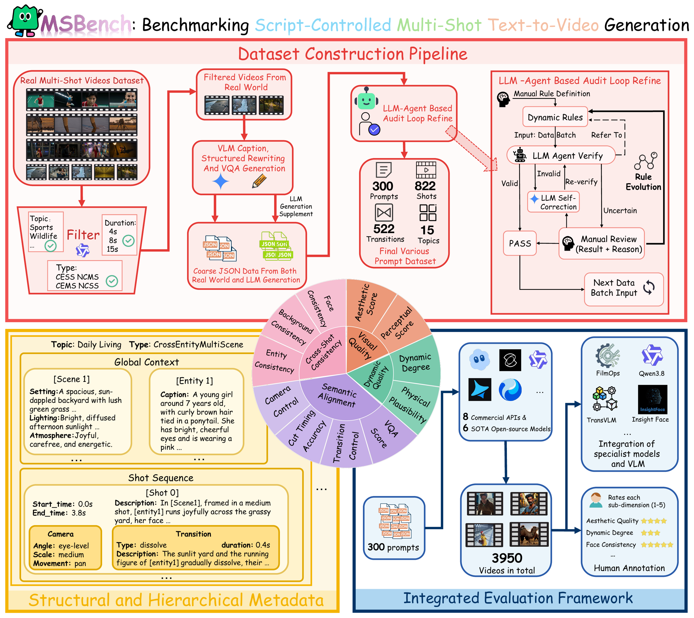

<div align="center">

[English](README.md)

# <a href="https://totalhuang.github.io/MSBench-page/"></a> MSBench：面向脚本控制的多镜头文生视频评测基准

Tao Huang<sup>1</sup>, ZiHao Liang<sup>1</sup>, Junhao Liu<sup>2</sup>, Junzhe Li<sup>2</sup>, Yuancheng Wei<sup>2</sup>,
Sifan Zuo<sup>1</sup>, Beiming Yu<sup>1</sup>, Taojin Liu<sup>1</sup>, Zhuoyang Li<sup>1</sup>, Bing Cao<sup>1</sup>

<sup>1</sup>天津大学 &nbsp;&nbsp; <sup>2</sup>北京大学

<a href="https://totalhuang.github.io/MSBench-page/"></a>
<a href="https://arxiv.org/abs/2611.29417"></a>
<a href="https://huggingface.co/datasets/totalhuang/MSBench"></a>

</div>

<p align="center"></p>

## 🔥 新闻

- **[2026.11]** 🎉 发布论文、评测代码与 300 条评测 prompts。

## ✅ 待办

- [x] 开源论文（[arXiv](https://arxiv.org/abs/2611.29417)）
- [x] 开源评测代码
- [x] 开源评测数据集 prompts（300 条 4 s / 8 s / 15 s 脚本，[Hugging Face](https://huggingface.co/datasets/totalhuang/MSBench)）
- [ ] 开源被测系统的评测视频

## 🔎 概览

MSBench 检验文生视频系统能否按**多镜头脚本**生成：脚本为每个镜头规定时间段、机位（景别、角度、运镜）、内容，以及接到下一个镜头的转场。

- **300 条 Scene-Entity-Shot 脚本**，共 822 个镜头、522 个转场、15 个主题；4 s 与 8 s 各 125 条（基础集），15 s 50 条（扩展集）。
- **4 个维度、11 个子指标**：视觉质量（美学、感知质量）、动态质量（动态程度、物理合理性）、语义对齐（VQA、转场控制、切点时间准确度、相机控制）、跨镜头一致性（实体、背景、人脸）。
- **混合式、经人工验证的评测**：镜头边界和转场类型由专用检测器（OmniShotCut、TransVLM）给出，再由 VLM 评委复核；每个子指标选用与人工评分最一致的专家模型或评委 prompt。所有评测模型都是开源权重，VLM 评委为 Qwen3.8-27B。

## 🏆 榜单

见 [英文 README](README.md#-leaderboard)（基础集 250 条，分数 0–100，Final 为四个维度的均值）。

## 🛠️ 环境与 🧱 下载

Linux + NVIDIA GPU（单张 48 GB 卡可以跑全部模型；其中 FilmOps `camera_movement` 约需 40 GB 显存）、Python 3.10–3.12、CUDA 12.x（Blackwell / `sm_120` 显卡需用 `cu128` 版 PyTorch）、FFmpeg。Q-Align 和 DeQA 依赖旧版 `transformers`，各用独立环境，其余都在主环境里；使用 `uv`（hardlink 缓存）管理时三套环境可共享底层 PyTorch/CUDA 文件，不重复占空间。安装命令见英文 README 的 Environment 一节，权重下载：

```bash
bash scripts/setup_third_party.sh   # 克隆 OmniShotCut、TransVLM、DEVIL、dinov2、FilmOps、Q-Align
bash scripts/download_models.sh     # 约 78 GB 权重，放到 models/（已通过 --include/--exclude 仅下载评测所需子权重）
```

> `download_models.sh` 仅拉取 MSBench 实际用到的部分权重（如 `Neo961/FilmOps` 仅下 `shot_scale`、`camera_angle`、`camera_movement` 以及 `shot_scale` 所需的 `dinov2_vitb14_pretrain.pth`，`DeQA-Score-Mix3` 仅下 `safetensors`）；另外需将 `princeton-vl/RAFT` 的 `raft-things.pth` 手动放进 `models/DEVIL/`。

## 🤖 VLM 评委

转场类型、人脸指认、PP、CSEC/CSBC 和 VQA 五个阶段会调用 Qwen3.8-27B，有两种方式：

1. **阿里云百炼（默认，论文结果使用此方式）**：`cp .env.example .env`，填入 `DASHSCOPE_API_KEY`。
2. **自行部署**：用任意 OpenAI 兼容服务（我们测试过 vLLM）部署 Qwen3.8-27B，然后指定地址：

```bash
python -m msbench judge --metric pp --results results/my_model \
    --judge-backend openai --judge-url http://<ip>:<port>/v1 --judge-model Qwen3.8-27B
```

也可以在 `.env` 中设置 `MSB_JUDGE_BACKEND=openai`、`MSB_JUDGE_URL`、`MSB_JUDGE_MODEL`。本仓库不提供部署代码；自建评委的分数与 API 接近，但不完全相同。每个评委阶段都支持 `--dry-run`（只统计请求数并打印一个 prompt，不发请求）。

## 🚀 快速开始

**冒烟测试**：`videos/example/` 里有两条适用全部子指标的视频（8 s 和 15 s，Seedance 2.0）。下面的命令会对它们跑完整流程，并与论文结果（`tests/reference_scores.json`）对比；通过即说明全量评测也能跑通。

```bash
bash scripts/smoke_test.sh     # 自建评委时加 --judge-backend openai --judge-url http://<ip>:<port>/v1
```

**评测自己的系统**：

1. 用被测系统为每条脚本生成一个视频（输入 `t2v_prompt`），按脚本 key 命名：`videos/my_model/<sample_id>.mp4`。超出脚本时长的视频会被截断。
2. 运行完整流程：

```bash
bash scripts/evaluate.sh my_model videos/my_model
# 使用自建评委：
bash scripts/evaluate.sh my_model videos/my_model --judge-backend openai --judge-url http://<ip>:<port>/v1
```

模型级分数在 `results/my_model/summary.md`，逐视频分数在 `results/my_model/final_scores.jsonl`。每个阶段都可以断点续跑，重新执行同一命令即可。指标细节见 [docs/METRICS.md](docs/METRICS.md)。

## 🤖 给 AI Agent 的提示词

如果你用编程 agent（Claude Code、Codex、Cursor 等）跑评测，可以把下面的提示词复制给它，填好 `<...>` 字段，在有 GPU 的机器上让它执行。agent 会按 [agent/msbench-eval/SKILL.md](agent/msbench-eval/SKILL.md) 的流程工作，调用付费评委前会先问你。

**完整评测（配环境 + 冒烟测试 + 正式评测）**

```text
请用官方仓库 https://github.com/totalhuang/MSBench 在 MSBench 上评测我的文生视频模型。

- 模型名：<MODEL_NAME>
- 生成视频目录：<VIDEO_DIR>（data/benchmark.json 里每条脚本对应一个 <sample_id>.mp4）
- VLM 评委：<"百炼 DashScope API，key 已写在 .env" 或 "我自己部署的 OpenAI 兼容服务 http://<ip>:<port>/v1，模型 Qwen3.8-27B">
- GPU：<例如 1 张 48 GB，CUDA 12.x>

步骤：
1. 克隆仓库（已有则跳过），先完整阅读 README.md 和 agent/msbench-eval/SKILL.md 再动手；与你自己的假设冲突时以它们为准。
2. 按 README「Environment」一节建好三个 conda 环境（msbench、msbench-qalign、msbench-deqa），运行
   scripts/setup_third_party.sh 和 scripts/download_models.sh。已有的环境和权重直接复用。
3. 对照 data/benchmark.json 检查我的视频：报告缺失或多余的 key，以及 4 s / 8 s / 15 s 各有多少条。
   如果我的模型不能生成 15 s 视频，只评测 250 条基础脚本。
4. 运行 scripts/smoke_test.sh（带上我的评委参数），确认通过后再正式评测。
5. 在 tmux 或 nohup 里运行 scripts/evaluate.sh <MODEL_NAME> <VIDEO_DIR>（带上评委参数）。某个阶段失败时，
   读报错、修正原因后重跑同一条命令（每个阶段都能断点续跑）。
6. 汇报 results/<MODEL_NAME>/summary.md：基础集（4 s + 8 s）一行与 README 榜单并列，15 s 单独一行，
   并列出标为 MISSING 的视频。

要求：每个评委阶段开始前，告诉我用的后端、请求数（用 --dry-run 统计）和预计费用，等我确认再跑。
不要打印或提交我的 API key。除非我要求，不要部署模型服务，也不要改指标代码。
```

**只跑评测（环境和权重已就绪）**

```text
在我的 MSBench 仓库（<REPO_PATH>）里，先读 agent/msbench-eval/SKILL.md，再用 scripts/evaluate.sh 把 <VIDEO_DIR>
里的视频作为模型 <MODEL_NAME> 评测，评委用 <百炼 DashScope API | http://<ip>:<port>/v1>。调用付费评委前先问我，
失败的阶段断点续跑而不是从头开始，最后汇报 summary.md 的表格和 MISSING 的视频。
```

**先生成视频**

```text
读取 https://github.com/totalhuang/MSBench 里的 data/benchmark.json（Hugging Face 上也有：totalhuang/MSBench）。
对每条脚本，把它的 `t2v_prompt` 原样输入我的模型 <MODEL / API>，生成 `duration_s` 秒的视频，保存为
<VIDEO_DIR>/<sample_id>.mp4。不要改写提示词，记录失败的 key 并重试，最后告诉我每种时长各生成了多少条。
```

## 📄 许可

代码采用 [MIT License](LICENSE)，基准脚本供研究使用。

## 📚 引用

如果 MSBench 对你的研究有帮助，请引用：

```bibtex
@article{huang2026msbench,
  title         = {MSBench: Benchmarking Script-Controlled Multi-Shot Text-to-Video Generation},
  author        = {Huang, Tao and Liang, ZiHao and Liu, Junhao and Li, Junzhe and Wei, Yuancheng and
                   Zuo, Sifan and Yu, Beiming and Liu, Taojin and Li, Zhuoyang and Cao, Bing},
  journal       = {arXiv preprint arXiv:2611.29417},
  eprint        = {2611.29417},
  archivePrefix = {arXiv},
  primaryClass  = {cs.CV},
  year          = {2026}
}
```
